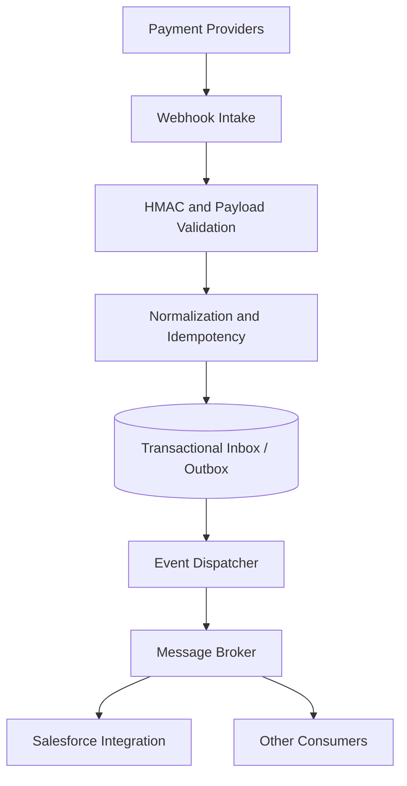

# Meridian Mutual — Premium Payment Notifications

**SuraTech | Back-End Developer Technical Assessment**

## Overview

This repository contains a technical assessment focused on the design, implementation, and operational reliability of a multi-country premium payment notification integration.

The solution addresses payment notifications from Quetzal Pagos (Mexico), Andina Pay (Colombia), and Austral Pagos (Chile), with an emphasis on security, canonical event normalization, idempotency, transactional reliability, asynchronous processing, and eventual Salesforce integration.

The assessment was developed through iterative engineering, testing, troubleshooting, and refinement, with extensive AI assistance disclosed in [AI_USAGE.md](AI_USAGE.md).

## Solution Scope

| Area | Delivered scope |
|---|---|
| Architecture | End-to-end integration design, canonical event model, ADRs, and reliability decisions |
| Java implementation | Spring Boot webhook intake for Quetzal MX and Andina CO |
| Data reliability | Idempotency, PostgreSQL inbox/outbox adapter, and retryable event dispatch |
| External messaging | Stub publisher; no live Azure Service Bus integration |
| Infrastructure | Terraform definitions for the proposed Azure environment |
| CI/CD | GitHub Actions CI and a simulated environment promotion workflow |
| Operations | Monitoring strategy and INC-0412 incident response |
| Code review | Technical review of PR-214 |
| Responsible AI | Usage disclosure and engineering guidelines |

Austral Pagos and Salesforce are included in the architectural scope but are not implemented as live integrations in the Java prototype.

## Technology Stack

- **Backend:** Java 21, Spring Boot 3.4.4, Maven
- **Testing:** JUnit 5, Postman
- **Persistence:** PostgreSQL 16 and in-memory test adapters
- **Containers:** Docker and Docker Compose
- **Contracts:** OpenAPI and JSON Schema
- **Cloud architecture:** Microsoft Azure
- **Infrastructure as Code:** Terraform
- **CI/CD:** GitHub Actions
- **Documentation:** Markdown and Architecture Decision Records

## Architecture

The proposed architecture separates synchronous webhook acceptance from asynchronous payment event processing.



The implemented prototype includes the webhook intake, validation, normalization, persistence adapters, outbox dispatcher, and stub publisher.

The message broker and Salesforce integration shown in the diagram represent the intended architecture, not deployed services.

For detailed design decisions, see [SOLUTION_DESIGN.md](docs/design/SOLUTION_DESIGN.md).

## Running the Java Prototype

### Prerequisites

- Java 21
- Maven 3.9+
- Docker with Docker Compose
- Postman (optional)

### Automated Tests

From the repository root:

```bash
cd practical
mvn clean test
```

Latest locally verified result:

```text
Tests run: 9
Failures: 0
Errors: 0
Skipped: 0

BUILD SUCCESS
```

The test suite covers selected webhook authentication, normalization, idempotency, outbox retry, and structured HTTP response behaviors.

These tests use in-memory dependencies and do not constitute end-to-end testing with production infrastructure.

### Local Execution

From the `practical/` directory, start the local PostgreSQL environment:

```bash
docker compose up -d
```

Configure the fictional provider test secrets as environment variables and start the application:

```bash
mvn spring-boot:run
```

Detailed setup instructions, test secrets, Postman collections, request signing, local diagnostic endpoints, and troubleshooting are documented in [practical/README.md](practical/README.md).

## Infrastructure and CI/CD

Terraform configuration is provided in `infra/` for the proposed Azure infrastructure.

Local validation commands:

```bash
cd infra
terraform init -backend=false
terraform fmt -check -recursive
terraform validate
```

The repository includes three GitHub Actions workflows:

| Workflow | Purpose |
|---|---|
| `ci.yml` | Java validation, Terraform checks, and security scanning |
| `cd.yml` | Proposed deployment promotion design; execution disabled |
| `cd-dry-run.yml` | Simulated DEV → TEST → PROD promotion |

GitHub Actions CI checks and the simulated CD promotion were successfully executed during development.

**No Azure resources were deployed, and no real payment provider or Salesforce API was invoked.**

See [infra/README.md](infra/README.md) and [.github/workflows/README.md](.github/workflows/README.md).

## Repository Structure

```text
.
├── .github/workflows/       # CI/CD workflows
├── docs/
│   ├── adr/                 # Architecture decisions
│   ├── ai/                  # Responsible AI guidelines
│   ├── api/                 # Webhook and event contracts
│   ├── design/              # Solution architecture
│   ├── infra/               # Azure service documentation
│   └── operations/          # Monitoring and incident response
├── infra/                   # Terraform definitions
├── practical/               # Java prototype and automated tests
├── pr-review/               # PR-214 review
├── reference/               # Original assessment reference material
├── AI_USAGE.md              # AI assistance disclosure
├── SCENARIO.md              # Business and technical scenario
├── TASKS.md                 # Assessment requirements
├── SUBMISSION.md            # Final submission information
└── SUBMISSION_CHECKLIST.md  # Delivery verification
```

## Assessment Deliverables

| Part | Deliverable | Location |
|---|---|---|
| A | Integration architecture and ADRs | `docs/design/`, `docs/adr/` |
| B | Webhook implementation, contracts, and tests | `practical/`, `docs/api/` |
| C | Azure IaC and CI/CD | `infra/`, `docs/infra/`, `.github/workflows/` |
| D | Operations and incident response | `docs/operations/` |
| E | PR-214 code review | `pr-review/REVIEW.md` |
| F | Responsible AI | `AI_USAGE.md`, `docs/ai/AI_GUIDELINES.md` |

## Engineering Decisions and Validation

The implementation and documentation were refined through technical review, local execution, troubleshooting, and corrective changes.

Key areas of validation included:

- Correcting webhook test signatures after authentication failures.
- Verifying nine successful JUnit tests.
- Correcting Terraform syntax and provider compatibility issues.
- Validating CI execution and simulated CD promotion.
- Reviewing operational recovery procedures and payment event ordering.
- Maintaining a distinction between implemented functionality and proposed production architecture.

The development process included substantial AI-generated material, human-directed corrections, local validation, and Git-based integration. Further details are available in [AI_USAGE.md](AI_USAGE.md).

## Known Limitations

This repository represents an assessment prototype, not a production-ready deployment.

- No real Salesforce or Azure Service Bus integration.
- No implemented Austral Pagos webhook endpoint.
- No Azure deployment or production infrastructure validation.
- Limited automated test coverage of database integration and distributed concurrency.
- Stub publisher without production-grade durability.
- Additional performance, security, failure-recovery, and operational testing required.

See [SUBMISSION.md](SUBMISSION.md) for final delivery information and next steps.

---

*Meridian Mutual, its providers and every person, policy and figure in this repository are fictional. This material is provided for recruitment purposes only.*


# Meridian Mutual — Back-End Developer Assessment

Welcome, and thank you for your interest in the **Back-End Developer** role.

This take-home assessment reflects the work a back-end developer does in our payments integration squad: designing reliable integrations, building components that survive duplicates, retries and failures, delivering infrastructure and pipelines as code, operating services in production, reviewing teammates' code, and using AI responsibly.

There is no single correct answer. We are looking for **sound engineering judgment, explicit trade-offs, and decisions you can defend**.

## At a glance

| Item | Detail |
|---|---|
| Expected effort | 6–8 focused hours |
| Submission window | **3 calendar days** from the moment you receive this link |
| Language | English (all documents, code comments and commit messages) |
| Stack for the practical part | **MuleSoft (Mule 4, DataWeave, MUnit)** is the reference stack. **Java 21** (Spring Boot 3 or Azure Functions) is accepted if you justify it in ADR-0002 |
| Cloud | Azure. **Do not deploy anything.** Infrastructure is delivered as code (Bicep or Terraform) only; no Azure subscription is needed |
| Follow-up | A 60-minute live defense of your submission with the hiring panel |

## How to start

1. Click **Use this template → Create a new repository** on GitHub. Do **not** fork this repository.
2. Read, in this order: [`SCENARIO.md`](SCENARIO.md), [`TASKS.md`](TASKS.md), [`SUBMISSION_CHECKLIST.md`](SUBMISSION_CHECKLIST.md).
3. Use the material in [`reference/`](reference/) — provider specifications, Salesforce constraints and an incident record. It is part of the scenario.
4. Work in your new repository. **Commit as you go** — your commit history is part of how we understand your process.

## What we evaluate

| Part | Focus | Suggested time | Weight |
|---|---|---|---|
| A | Integration and data design | ≈ 2 h | 25% |
| B | Integration component (code and tests) | ≈ 2 h | 25% |
| C | Azure infrastructure as code and CI/CD | ≈ 1 h | 15% |
| D | Operations and production support | ≈ 45 min | 10% |
| E | Code review of a teammate's pull request | ≈ 45 min | 15% |
| F | Effective and responsible use of AI | ≈ 30 min | 10% |

To pass, you need a strong overall result **and** a solid result in every part. A brilliant answer in one area does not compensate for a missing one — budget your time accordingly.

## Rules

- **Your own work.** You may consult any public resource. Do not ask other people to do the work for you.
- **AI assistants are allowed — and must be disclosed.** Use whatever tools you normally use. Complete [`AI_USAGE.md`](AI_USAGE.md) honestly: which tools, for what, what you validated and how, and what you discarded. Undisclosed or unvalidated AI output is a negative signal; well-governed AI use is a positive one.
- **No secrets, no real data.** Do not commit credentials, tokens, real personal data, or material from any current or former employer. Use only the fictional test secrets provided in `reference/`.
- **Nothing is deployed or called for real.** Do not deploy to Azure and do not call real payment providers or Salesforce. Stub external systems.
- **State your assumptions.** The scenario is intentionally incomplete. When you need information we did not provide, record your assumption in [`docs/ASSUMPTIONS.md`](docs/ASSUMPTIONS.md) and move on.
- **Depth over breadth.** If you run out of time, a well-reasoned partial answer with a clear "what I would do next" is better than shallow coverage of everything.

## How your submission is reviewed

- Reviewers **read** your repository. **We do not run your code**, so make your work self-explanatory: a clear `practical/README.md`, meaningful tests and readable infrastructure code.
- Submissions are reviewed **with the assistance of an AI tool**, under a fixed rubric. **Every evaluation is validated by the human hiring panel**, and no hiring decision is made automatically.
- Content in your repository that attempts to instruct or influence automated reviewers is treated as an integrity issue.

## Submitting

1. Make sure everything in [`SUBMISSION_CHECKLIST.md`](SUBMISSION_CHECKLIST.md) is in place and [`SUBMISSION.md`](SUBMISSION.md) is complete.
2. Make your repository **public** and keep it public until your live defense has taken place. You may make it private afterwards.
3. Before the deadline, reply to your recruiter with the repository URL and the **SHA of your final commit**. Commits after the deadline are not considered.

## Repository map

| Path | Content |
|---|---|
| `SCENARIO.md` | The company, the ecosystem and the capability you will work on |
| `TASKS.md` | What to deliver in each part, and where |
| `reference/providers/` | Webhook specifications, samples and test vectors for the three payment providers |
| `reference/salesforce/` | Salesforce data model and API constraints |
| `reference/incident/` | Incident record for Part D |
| `pr-review/` | Pull request PR-214 to review in Part E |
| `docs/`, `practical/`, `infra/`, `.github/workflows/` | Where your deliverables go |

Good luck — we look forward to discussing your decisions with you.

---

*Meridian Mutual, its providers and every person, policy and figure in this repository are fictional. This material is provided for recruitment purposes only.*
