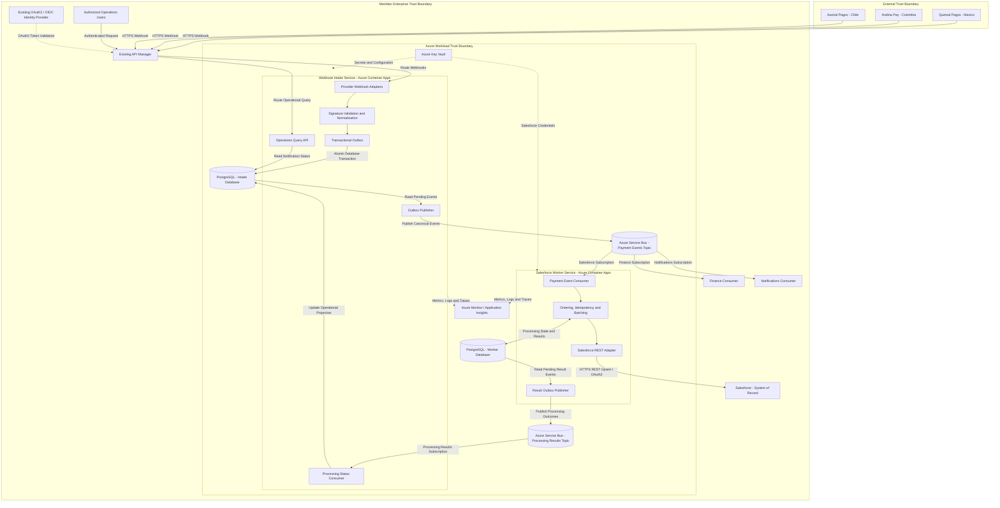
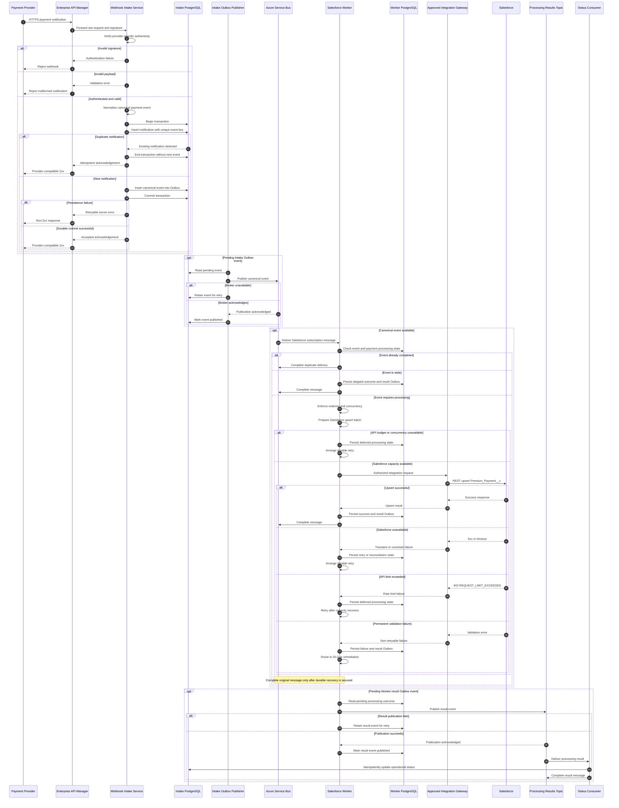

# Solution Design — Premium Payment Notifications

## 1. System Context and Architecture Overview

### 1.1 Microservice Boundaries and Data Ownership

The proposed solution adopts an event-driven microservices architecture based on Java 21, Spring Boot 3, Hexagonal Architecture, and Azure-managed services.

The architecture consists of two independently deployable and scalable microservices, each with clearly defined responsibilities and independent data ownership.

**Webhook Intake Service**

The Webhook Intake Service is responsible for receiving payment notifications from Quetzal Pagos (Mexico), Andina Pay (Colombia), and Austral Pagos (Chile).

Its main responsibilities include:

- Validating provider-specific webhook signatures and request timestamps.
- Transforming provider payloads into a versioned canonical payment event.
- Enforcing notification idempotency using provider-specific business keys.
- Persisting accepted notifications and outgoing events atomically using the Transactional Outbox pattern.
- Publishing canonical payment events asynchronously to Azure Service Bus.
- Exposing secured operational endpoints for tracking notification processing status.

The Outbox Publisher operates as an internal component of the Webhook Intake Service. It retrieves pending events from PostgreSQL, publishes them to Azure Service Bus, and records publication outcomes.

A successful webhook response is returned only after the notification and its corresponding Outbox event have been durably committed.

**Salesforce Worker Service**

The Salesforce Worker Service is responsible for consuming canonical payment events and integrating them with Salesforce.

Its main responsibilities include:

- Consuming payment events from a dedicated Azure Service Bus subscription.
- Enforcing idempotent processing and payment-state ordering rules.
- Preventing outdated notifications from overwriting newer payment states.
- Grouping compatible payment records into batches to optimize Salesforce API consumption.
- Performing idempotent Salesforce REST upserts using stable external payment keys.
- Managing transient failures, retries, dead-letter handling, and processing outcomes.
- Persisting processing results and publishing operational status events through a recoverable Outbox mechanism.

Salesforce remains the system of record for payment and policy information. The integration updates payment records only; policy reinstatement is handled by existing Salesforce automation.

**Data Ownership and Operational Visibility**

Each microservice owns its persistence model. Direct database access between services is prohibited to prevent tight coupling and preserve independent evolution.

The Webhook Intake Service maintains notification records, idempotency keys, Outbox events, and an operational status projection.

The Salesforce Worker Service maintains payment-processing state, Salesforce integration outcomes, and pending processing-result events.

Operational visibility is implemented through asynchronous processing-result events. A dedicated Processing Status Consumer updates the operational projection maintained by the Webhook Intake Service.

This enables authorized Operations users to track notifications throughout their lifecycle without accessing the Salesforce Worker database or searching application logs.

Because Salesforce REST operations and local PostgreSQL transactions cannot be committed atomically, the Worker uses stable external payment keys, idempotent upserts, and reconciliation procedures to recover from uncertain outcomes.

### 1.2 Deployment and Scalability

Both microservices are packaged as independent Docker images and designed for deployment on Azure Container Apps.

This approach provides independent deployment, horizontal scaling, and managed container execution without requiring a dedicated Kubernetes cluster.

The Webhook Intake Service scales according to incoming HTTP traffic and webhook processing demand.

The Salesforce Worker Service scales according to Azure Service Bus message backlog, processing latency, and Salesforce integration capacity.

Azure Service Bus decouples notification ingestion from downstream processing through a payment-events topic and independent subscriptions for Salesforce, Finance, and Notifications.

A separate processing-results topic communicates Salesforce processing outcomes back to the operational status projection.

The Salesforce Worker applies coordinated rate limiting and concurrency controls to respect Salesforce's maximum of 25 concurrent integration requests and its allocated budget of 150,000 API calls per rolling 24 hours.

The design accommodates temporary Salesforce unavailability by retaining pending messages for asynchronous processing and applying controlled retries.

PostgreSQL provides transactional consistency, unique constraints, indexing, and durable storage for notification and processing state. Each microservice maintains separate logical databases and access credentials.

The architecture supports future payment providers by introducing new provider-specific adapters without modifying the canonical payment-processing domain or requiring changes to downstream consumers.

### 1.3 Trust Boundaries and Security

The architecture defines three primary trust boundaries:

**External Provider Boundary**

Payment providers communicate with Meridian through HTTPS webhooks exposed by the existing API Manager.

Each provider's webhook adapter validates the corresponding HMAC signature, timestamp tolerance, and required request fields before accepting the notification.

Invalid or unauthenticated notifications are rejected without producing canonical payment events.

**Meridian Enterprise Boundary**

The existing API Manager provides the controlled entry point for externally exposed APIs and authorized operational queries.

Operational endpoints require OAuth 2.0 authentication and role-based authorization through Meridian's existing identity provider.

**Azure Workload Boundary**

The Webhook Intake Service and Salesforce Worker Service operate within the Azure workload environment.

Azure managed identities are used where supported to authenticate against Azure resources, including Service Bus and Key Vault, following the principle of least privilege.

Salesforce authentication uses OAuth 2.0 client credentials. Credentials are securely managed through Azure Key Vault, and access tokens are cached and reused according to their validity.

Application telemetry is centralized through Azure Monitor and Application Insights.

Sensitive payment information, authentication secrets, and personally identifiable information must not be exposed through application logs, traces, or operational responses.

All inter-service messages use versioned contracts, and access to messaging subscriptions and databases is restricted to authorized components.

## 2. End-to-End Payment Notification Processing

### 2.1 Sequence Diagram

### 2.2 Notification Processing and Reliability Guarantees

The proposed payment notification workflow separates synchronous webhook acceptance from asynchronous Salesforce processing. This design prioritizes durability, idempotency, operational traceability, and controlled downstream integration.

**Webhook Authentication and Validation**

Payment providers submit HTTPS notifications through Meridian's existing API Manager.

The Webhook Intake Service selects the appropriate provider adapter and validates each request according to the provider's documented authentication scheme, payload format, and applicable replay-protection requirements.

Invalid signatures and malformed notifications are rejected before any canonical payment event is published.

The service preserves the original request bytes required for signature verification and applies provider-specific validation before transforming the notification.

**Canonical Event Generation and Durable Acceptance**

After successful validation, the Webhook Intake Service transforms the provider notification into a versioned canonical payment event.

The service derives a provider-specific idempotency key and starts a PostgreSQL transaction.

Within the same transaction, it persists the accepted notification and its corresponding Outbox event.

A successful HTTP acknowledgement is returned only after the transaction commits.

Duplicate notifications are identified through unique database constraints and acknowledged without producing additional canonical events.

If persistence fails, the service returns a non-success response so that the provider can retry according to its documented delivery policy.

Response codes and timing must comply with each provider's webhook specification.

**Asynchronous Event Publication**

The Intake Outbox Publisher retrieves pending canonical events from PostgreSQL and publishes them to an Azure Service Bus topic.

Independent subscriptions allow the Salesforce Worker, Finance, and Notifications consumers to process events without coupling their availability or execution schedules.

If publication fails, the event remains stored in PostgreSQL and is retried.

If publication succeeds but the publisher fails before marking the event as delivered, duplicate publication is possible.

Consumers must therefore support at-least-once delivery and idempotent processing.

**Salesforce Processing and Ordering**

The Salesforce Worker consumes canonical events from its dedicated Service Bus subscription.

Before performing an integration operation, it checks the event identifier, existing processing outcome, and the latest known payment state.

The Worker applies provider-specific ordering and reconciliation rules to prevent delayed notifications from overwriting newer payment states.

Events that have already been processed are acknowledged without repeating the business operation.

Stale events are recorded as skipped and do not modify Salesforce.

Eligible events are grouped into compatible batches when appropriate to reduce Salesforce API consumption.

The Worker performs authorized integration requests through Meridian's approved enterprise integration path.

Payment records are created or updated in Salesforce using stable external identifiers and idempotent upsert operations.

The integration updates `Premium_Payment__c` records only. Policy reinstatement remains the responsibility of existing Salesforce automation.

**Salesforce Availability and API Protection**

Salesforce availability is approximately 97% per month, with documented outage windows typically ranging from 5 to 90 minutes.

The Salesforce Worker uses asynchronous processing, controlled concurrency, batching, and durable retries to tolerate temporary outages.

The integration must respect a maximum of 25 concurrent Salesforce requests and a budget of 150,000 API calls per rolling 24-hour period.

The Worker also accounts for the shared Salesforce organization-wide API limit.

When Salesforce returns `REQUEST_LIMIT_EXCEEDED`, processing is deferred until API capacity becomes available.

Transient server failures, connection errors, and record-locking conflicts are retried using bounded exponential backoff with jitter.

Permanent validation errors are not repeatedly submitted without correction.

Expired Salesforce access tokens are refreshed according to the supported OAuth 2.0 client credentials flow, and valid tokens are cached for reuse.

**Dead-Letter Handling and Safe Recovery**

Messages that cannot be processed after the configured retry policy are placed in a dead-letter queue or durable remediation state.

Dead-letter records preserve the event identifier, correlation identifier, failure classification, retry history, and operational status.

Reprocessing must preserve the original business identifiers and idempotency guarantees.

Before replaying an uncertain Salesforce operation, the Worker reconciles the payment against Salesforce using its stable external identifier.

A message is acknowledged to Azure Service Bus only after successful processing or after responsibility for its recovery has been durably transferred to a retry, reconciliation, or dead-letter mechanism.

**Operational Status and Traceability**

The Salesforce Worker persists processing outcomes and corresponding result Outbox events in its PostgreSQL database.

A recoverable publisher sends these outcomes to a dedicated Azure Service Bus topic.

The Processing Status Consumer updates the operational projection maintained by the Webhook Intake Service.

Authorized Operations users can search notifications using provider identifiers and inspect their processing status without querying raw application logs.

The operational model distinguishes notification acceptance, publication, Salesforce recording, processing failures, and dead-lettered outcomes.

A correlation identifier is propagated across the HTTP request, canonical event, messaging infrastructure, Salesforce processing, and operational status events.

Sensitive payer information and authentication credentials are excluded from application logs and telemetry.

**Delivery and Freshness Guarantees**

The architecture provides at-least-once event delivery with idempotent business processing.

Unique constraints, stable identifiers, ordered state transitions, recoverable Outbox publication, and Salesforce external-ID upserts prevent duplicate business effects.

No distributed transaction is assumed between PostgreSQL, Azure Service Bus, and Salesforce.

The system is designed to target the required freshness objectives:

- At least 95% of payments visible in Salesforce within 5 minutes of the provider notification.
- At least 99.5% visible within 1 hour.

These objectives must be validated through capacity calculations, queue-lag monitoring, end-to-end latency measurements, and failure-recovery testing.

The design must also ensure that no notification acknowledged with a successful HTTP response is lost, including during broker or Salesforce outages.

### 2.3 Idempotency Strategy

Idempotency is enforced at three boundaries: webhook intake, Service Bus consumption, and Salesforce persistence. Transport delivery remains at least once; the objective is to prevent duplicate business effects.

| Provider | Notification idempotency key | Stable payment key (`Payment_Key__c`) | Rationale |
|---|---|---|---|
| Quetzal (MX) | `Quetzal:{id}` | `MX:{data.charge.id}` | `id` remains stable across delivery retries, while multiple event types can affect one charge. |
| Andina (CO) | `Andina:{transaccion.id}:{transaccion.estado}` | `CO:{transaccion.id}` | `notificacion_id` changes on each retry. Transaction ID and state identify the same business event across retries. |
| Austral (CL) | `Austral:{eventId}` | `CL:{payment.paymentId}` | `eventId` is stable across retries; multiple events may affect one payment. |

The Intake database has a unique constraint on `(provider, notification_business_key)` and stores the original delivery identifier separately for operational lookup. The notification record and canonical Outbox event are inserted in the same transaction. An identical duplicate returns the provider-compatible success response without another Outbox event. If a repeated key carries conflicting business content, the request is quarantined for investigation rather than silently discarded.

The Worker enforces a unique `(consumer_name, canonical_event_id)` processing key and serializes state transitions for the same payment key. `Premium_Payment__c.Payment_Key__c` is a Salesforce unique external ID and is used for upserts. The Worker must reconcile uncertain responses before retrying, because a Salesforce write can succeed even if the HTTP response is lost. Stable payment keys alone do not prevent a stale update; ordering checks are also required.

For Andina, the documented `(transaction ID, state)` key cannot distinguish two genuine occurrences of the same state. The design assumes one business transition per state per transaction; conflicting repeats are quarantined and reconciled with the provider rather than treated as independent transitions. This assumption must be recorded in `docs/ASSUMPTIONS.md`.

### 2.4 Event Ordering and State Resolution

Events are ordered **per payment**, not globally. The Worker uses the provider payment key as the serialization key and persists the last accepted state, provider occurrence timestamp, canonical event ID, and Salesforce synchronization status. Processing for the same payment must be serialized across Worker replicas using a database lock or equivalent lease. Service Bus sessions may improve per-key sequencing but cannot correct out-of-order arrival at the provider boundary.

| Provider | Authoritative state-change time | State mapping |
|---|---|---|
| Quetzal | `data.charge.paid_at` for capture; `data.charge.refunded_at` for refund; otherwise `created` when no more specific transition timestamp exists | `charge.succeeded` → `Captured`; `charge.failed` → `Failed`; `charge.refunded` → `Refunded` |
| Andina | `transaccion.fecha_transaccion` | `PENDIENTE` → `Pending`; `APROBADA` → `Captured`; `RECHAZADA` → `Failed`; `REVERSADA` → `Refunded` |
| Austral | `payment.occurredAt` | `PAYMENT_CONFIRMED` → `Captured`; `PAYMENT_REJECTED` → `Failed`; `PAYMENT_REVERSED` → `Refunded` |

All timestamps are normalized to UTC. For a given payment, an event with an earlier authoritative state-change time than the last accepted state is recorded as `SKIPPED_STALE` and must not update Salesforce. A later valid reversal/refund supersedes an earlier capture. `Pending` must not overwrite a terminal state. `Failed` must not overwrite a later capture or refund. Equal timestamps with different states, invalid lifecycle transitions, or conflicting provider evidence are marked `RECONCILIATION_REQUIRED` rather than resolved by arrival order or a blanket numerical status rank.

The Worker compares and reserves the next valid state under the per-payment lock, then performs the Salesforce upsert through the approved enterprise integration path. A retry or reconciliation is required when the remote result is uncertain. The Worker must not release an earlier unresolved operation in a way that permits a later operation to be overwritten by a delayed retry. Salesforce `Status_Changed_At__c` and `Last_Event_Id__c` provide audit evidence, but the Worker remains responsible for state-transition checks; Salesforce's external-ID upsert alone does not implement ordering.

### 2.5 Retry, Dead-Letter and Replay Policy

The following values are **initial design settings**, not provider-mandated values. They must be tuned through load and incident testing.

| Failure category | Policy | Terminal or recovery action |
|---|---|---|
| Invalid webhook signature, timestamp or schema | Reject immediately; do not publish | Provider-specific non-2xx response, security metric, no business event |
| Intake PostgreSQL unavailable | No successful acknowledgement before commit | Return retryable non-2xx within provider timeout; rely on documented provider retries |
| Intake Outbox publication failure | Retry after 5 s, 15 s, 45 s, then exponential backoff capped at 5 min with jitter | Retain durable Outbox row and alert on age; never drop accepted event |
| Salesforce `500`, `502`, `503`, network timeout | Durable retry after 15 s, 30 s, 1 min, 2 min, 5 min, then up to 15 min with jitter | Reconcile uncertain writes before re-upsert; escalate if recovery exceeds 1 h |
| Salesforce `400 UNABLE_TO_LOCK_ROW` | Retry with short exponential backoff and jitter | Serialize per payment; escalate repeated contention |
| Salesforce `401 INVALID_SESSION_ID` | Refresh cached OAuth token and retry once | Escalate persistent authentication failures |
| Salesforce `403 REQUEST_LIMIT_EXCEEDED` or exhausted local quota | Pause Salesforce writes; resume after capacity is available | Keep durable deferred work; alert on quota pressure and queue age |
| Salesforce `400` field/validation error | Do not retry unchanged payload | Record `FAILED_PERMANENT`; send to DLQ/remediation after durable failure record |
| Repeated poison-message or mapping failure | Bounded delivery attempts; default maximum 10 | DLQ with correlation, payment key, sanitized error code and replay metadata |

A deferred message is **not completed** merely because a retry is planned. The Worker first persists a recoverable work item, its next-attempt time, and the outcome/Outbox state in its own database; only then may it complete the original Service Bus delivery. A scheduled dispatcher re-enqueues due work using stable event identifiers. Database transactions and broker acknowledgements are not atomic, so duplicate re-enqueueing is expected and handled by idempotency. Service Bus lock renewal is bounded; long Salesforce outages must not rely on holding an active message lock.

The Worker database retains `retry_count`, `next_attempt_at`, `failure_category`, `last_error_code`, `reconciliation_required`, and `processing_status`. A dedicated replay command accepts an event ID or DLQ message ID, verifies authorization, preserves the original canonical event and payment keys, checks the latest provider/Salesforce state when needed, and republishes through the same processing path. Replay is audited and cannot bypass ordering or idempotency. Operational alerts fire on DLQ count greater than zero, oldest pending event age over 5 minutes, and any unacknowledged durable intake event older than 1 minute. These are initial alert thresholds to be validated.

Provider-specific webhook acknowledgement constraints are: Quetzal any `2xx` within 10 seconds, Andina **only `200` or `204`** within 5 seconds, and Austral any `2xx` within 10 seconds. The Intake service should target a response well below the strictest 5-second deadline. The prior generic `202 Accepted` example is **not valid for Andina**.

### 2.6 Capacity, Salesforce API Budget and Freshness

The source workload is approximately 15,000 notifications/day normally and 120,000/day during month-end, including about 3% duplicates. The peak burst is 40 notifications/second for 15 minutes (36,000 deliveries). Assuming duplicates are evenly distributed, the month-end unique-event volume is approximately `120,000 × 0.97 = 116,400` events/day, or 1.35 unique events/second averaged across the day. The 40/second burst yields approximately 38.8 unique events/second. The Intake service and Outbox must handle the **full** incoming 40/second rate, since authentication and deduplication occur before suppression.

Salesforce allows up to 200 records in one collection upsert request, counted as one API call. The design uses a **target batch size of 100 records**, with a maximum wait of **2 seconds** for a ready batch; it flushes smaller batches to protect latency. This is a starting configuration, not a promise of 100-record occupancy during normal traffic. At 100 records per call, the theoretical month-end volume requires about `ceil(116,400 / 100) = 1,164` successful batch calls/day, excluding retries, reads, and reconciliation. In the worst case of one upsert per unique event, the same workload needs approximately 116,400 write calls/day, leaving only 33,600 calls for retries and other integration operations within the 150,000-call allocation. Batching is therefore essential for resilience and headroom, not merely cost optimization.

During a 40/second burst, 100-record batches would require roughly 0.4 Salesforce requests/second if batches fill. Using the documented p95 batch latency of 4 seconds, the average in-flight concurrency at that rate is approximately 1.6 requests; this is well below the maximum 25, but actual concurrency must be bounded across all Worker replicas. A conservative initial **global** Salesforce request cap of 10 concurrent calls and a rolling 24-hour request counter are proposed, with a reserve of at least 20% of the allocated budget for retries, reconciliation and operational traffic. These values are configuration choices and must be tested under partial failures.

The Salesforce team reports approximately 97% monthly availability and outages lasting 5–90 minutes. Therefore, the requirements that 95% of payments be visible within 5 minutes and 99.5% within 1 hour are **targets to measure**, not guarantees that can be met during every outage: a 90-minute complete outage makes the one-hour target impossible for notifications received near its beginning. The architecture minimizes controllable latency and supports catch-up, while reporting unavoidable upstream dependency breaches explicitly rather than masking them.

For illustration, a 90-minute outage at the **average month-end rate** accumulates approximately `120,000 / 86,400 × 5,400 ≈ 7,500` incoming notifications. At a sustained 40/second rate, 15 minutes contributes 36,000 deliveries. The queue and Outbox retention must safely hold these backlogs plus retry overhead. With 100-record batches, 36,000 unique records represent roughly 360 collection upsert requests, ignoring duplicates and retries. At a conservative 2 requests/second after recovery, that workload could be submitted in about 3 minutes, **excluding** record-level failures, upstream gateway overhead, and competing traffic. This is an illustrative throughput calculation, not a measured recovery guarantee.

Per-country dashboards track the elapsed time from the provider's event notification to confirmed Salesforce recording, with p95 and p99.5 freshness, accepted-but-unpublished Outbox age, Service Bus backlog age, success/failure/reconciliation counts, API call consumption, and DLQ depth. Load tests must reproduce the 40/second burst, normal month-end volume, Salesforce 5–90-minute outages, `REQUEST_LIMIT_EXCEEDED`, duplicate redelivery, and out-of-order refunds. Results and measured SLO compliance belong in the operational documentation.
